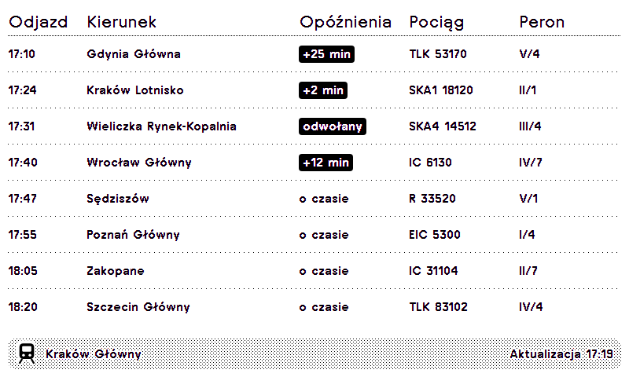
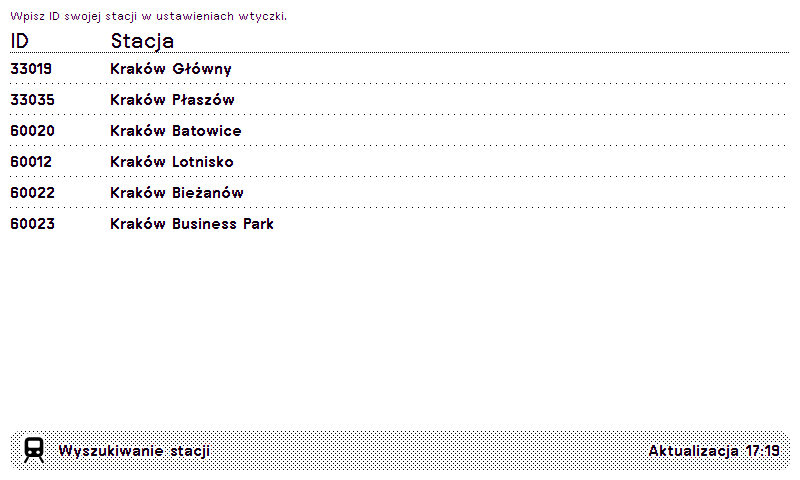

# PKP Departures – a TRMNL recipe for Larapaper

Live train departures for any Polish railway station on a TRMNL e-ink display. The data comes from the official PKP PLK Open Data API ([Otwarte Dane Kolejowe](https://pdp-api.plk-sa.pl/)).



The plugin supports all four layouts (full, half horizontal, half vertical, quadrant) and has Polish and English labels.

## Install on Larapaper

1. **Get an API key.** Request a free key at <https://pdp-api.plk-sa.pl/>. The Basic tier (100 requests per hour, 1,000 per day) is enough.
2. **Import the recipe.** In Larapaper, either import it from the OSS catalog (*Plugins → Import from OSS Catalog*), or download this repository as a ZIP (*Code → Download ZIP* on GitHub) and upload it under *Plugins → Import Recipe Archive*. Larapaper finds the recipe in `src/`.
3. **Set your time zone.** Go to *Settings → Preferences → Timezone* and choose `Europe/Warsaw`. The plugin uses this time zone to decide which trains have already left. You can also set `APP_TIMEZONE=Europe/Warsaw` on the server.
4. **Configure the plugin:**
   - **PKP PLK API key**: your key.
   - **Station ID**: leave this empty for now.
   - **Station search**: the start of the station name, e.g. `Kraków` or `Warszawa Cen`.
5. **Find your station ID.** Refresh the plugin data and open the preview. It lists the matching stations and their IDs:

   

6. **Enter the Station ID** and refresh again. The departure board appears.

Optional settings:

| Setting | Purpose |
|---|---|
| Display name | Overrides the station name shown in the title bar. |
| Carriers | Only shows these carriers, e.g. `IC` (PKP Intercity), `KM` (Koleje Mazowieckie), `PR` (Polregio), `KS` (Koleje Śląskie), `KML` (Koleje Małopolskie). Use this at very busy stations (see Limitations). |
| Language | `Polski` (default) or `English`. |

Keep the recipe on Larapaper's default PHP Liquid renderer. Don't switch it to the external `trmnl-liquid` renderer: that renderer passes the data on the command line, and the timetable is too large for it.

## How it works

Each refresh makes two requests, both with the `X-API-Key` header:

| | Endpoint | Used for |
|---|---|---|
| `IDX_0` | `/api/v1/schedules/shortened?stations=ID&fullRoute=true` | Planned departure time, train category and number, platform/track, and destination (the last stop of the full route) |
| `IDX_1` | `/api/v1/operations/shortened?stations=ID&withPlanned=true` | Live departure delay, cancellations, and whether the train has already left |

`shared.liquid` joins the two responses on schedule ID plus order ID (the train order ID when present). It then drops trains that have already departed and technical (non-passenger) stops, sorts the rest by time, and builds the table. The layout files only print the result.

A train counts as departed when the API has confirmed its departure (`cf`), or when planned time plus delay is already in the past. The actual-departure field (`ad`) alone isn't enough: for trains that haven't reached the station yet, it holds a forecast. Delayed trains are still shown up to 3 hours after their planned time.

Larapaper has no background timer for recipes. It only fetches new data when the device wakes up and the data is older than the plugin's refresh interval. The recipe's interval is 4 minutes: set the device (or playlist) to refresh every 5 minutes, and every wake-up gets fresh data. With a 5-minute interval, a wake-up that comes a few seconds early would be skipped and the screen would go 10 minutes without an update. On a 5-minute device cycle the plugin makes about 24 requests per hour, well inside the Basic tier. If several devices or plugin instances share one key, they share that limit.

## Limitations

- **The biggest stations exceed Larapaper's data limit.** Larapaper rejects polled data over 5 MB, measured as indented JSON, which is about 3.2× the size the API sends. The API has no destination field, so the plugin has to download every train's full route. Each timetable response also includes the names of all ~3,300 Polish stations, and live data covers three days of trains. The API has no way to select fields, filter by time of day, or return a smaller format. Measured in November 2026:

  | Station | Trains/day | Counted by Larapaper |
  |---|---|---|
  | Warszawa Centralna | 390 | 5.0 MB (at the limit) |
  | Kraków Główny | 542 | 8.1 MB (rejected) |

  When the limit is hit, the screen says so. Use the **Carriers** setting (e.g. `IC`) to bring the data under the limit.
- **Today's timetable only.** The API returns today's timetable, so late in the evening the board can't show trains that leave after midnight. Those appear once the date changes.
- **Delays need live data.** A train shows "o czasie" / "On time" until PLK publishes live data for it.
- **Technical stops are detected by name.** Stops whose stop-type name contains *techn*, *służb*, *przelot* or *bez zatrzym* are skipped. The API only provides stop types as Polish names, so this is a heuristic.

## Repository layout

```
src/           recipe source (trmnlp layout): settings.yml, shared.liquid, full / half_horizontal / half_vertical / quadrant .liquid
.trmnlp.yml    sample settings for previewing with trmnlp
dev/           mock data, local renderer and screenshot script
docs/          preview images
```

## Data source

Timetable and real-time data: **PKP Polskie Linie Kolejowe S.A.**, via the [PKP PLK Open Data API](https://pdp-api.plk-sa.pl/). Each user needs their own API key and must follow PLK's API terms.

## License

The plugin code is released under [MIT No Attribution](LICENSE) (MIT-0): use, copy, modify and redistribute it freely, without needing to credit the author. This covers the code only. Data shown by the plugin comes from PKP PLK and is subject to their API terms.

## Developing

To build a flat ZIP (`dist/pkp-departures.zip`) from `src/` for manual import:

```sh
python dev/build_zip.py
```

To preview the plugin locally without Larapaper, you need PHP 8.2+ with `mbstring` and the same Liquid engine version Larapaper uses (no Composer needed):

```sh
git clone https://github.com/keepsuit/php-liquid && git -C php-liquid checkout v0.12.1
PHP=php LIQUID_SRC=php-liquid/src OUT=dev/preview bash dev/preview.sh
```

`dev/preview.sh` regenerates the mock payloads (`dev/mock_data.py`), renders every layout and state with `dev/render.php`, and takes 800×480 screenshots with headless Edge or Chrome (set `BROWSER`). `render.php` reproduces Larapaper's render path: it prepends `shared.liquid`, adds the `view view--{size}` wrapper, and passes the same `trmnl.*` context.
